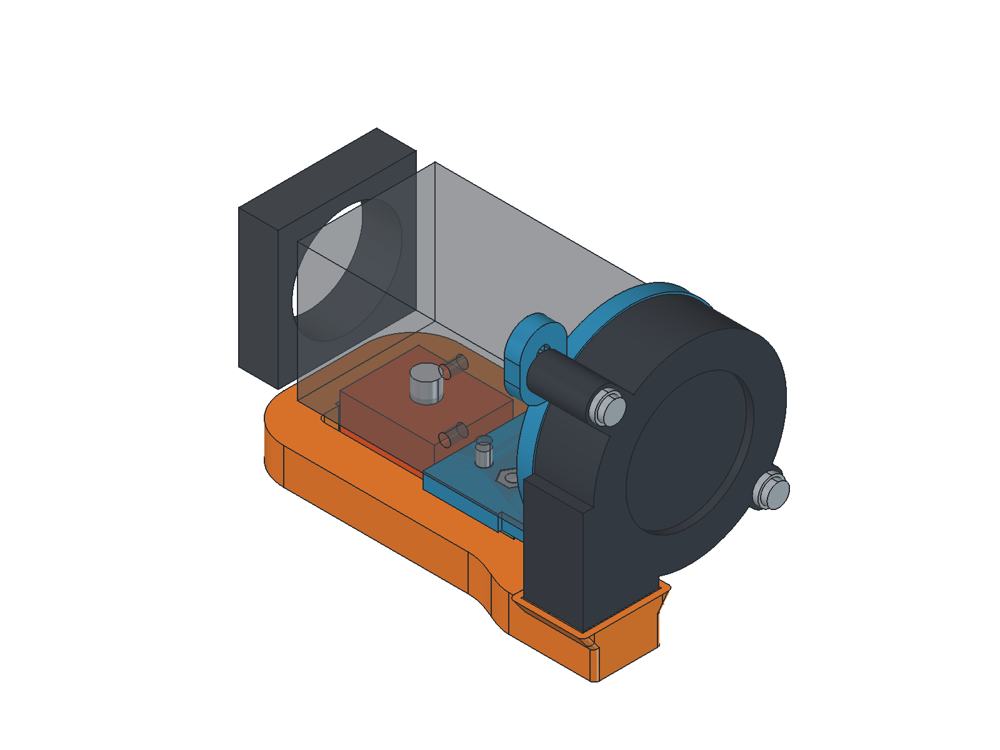
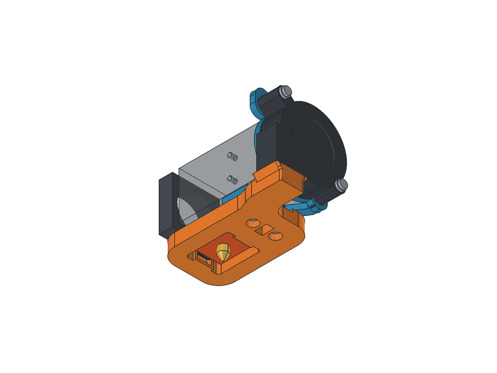
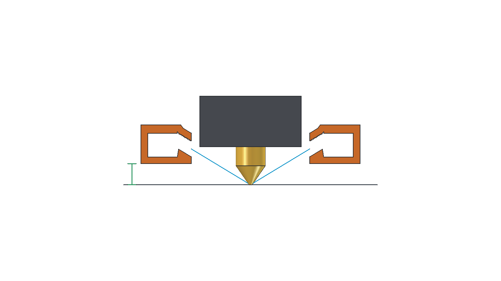

# BIQU H2 elevated slim O duct and outward-facing 5015

The current assembly is [`output/underside_down/H2_5015_Underside_Down.FCStd`](output/underside_down/H2_5015_Underside_Down.FCStd). Its fan and complete duct can be raised together by **0, 2 or 4 mm**, giving **5, 7 or 9 mm clearance above the nozzle tip**. Two removable spacers set the duct height; the fan slides vertically to maintain the inlet joint. The H2 mounting bracket and separate chain plate stay fixed.

| Assembly lift | Spacer at each duct bolt | Duct screws | Lowest duct above nozzle |
| --- | --- | --- | --- |
| 0 mm (saved assembly, recommended) | 4 mm | M3x12 | 5 mm |
| +2 mm | 2 mm | M3x10 | 7 mm |
| +4 mm | None | M3x8 | 9 mm |

Retain **2 mm of washers at each duct screw** in all three settings. Use matching spacers and screw lengths at both mounts, raise the blower by the same amount and reseal its butt joint. Use the saved 0 mm lift setting for the intended aim. Extra lift raises the airflow target and can direct part of the jet onto the heater sock; test cooling if using it.

Both fan nuts have open loading channels through the rear support arm. Both nut paths are checked through the full slot travel. The slots are 3.3 x 8.3 mm, with captive sliding nuts and 1.5 mm retaining floors. Their extra 1 mm downward reserve corrects real fan fit; it does not permit lowering the nominal duct below its 5 mm setting.

The duct is now **11 mm tall instead of 15 mm**, with **12.6% less modeled material**. Its X/Y footprint, fan position and bracket are retained. The ring is 9.2 mm deep instead of 11.2 mm, with nominal 7 x 6 mm air passages. A local low roof clears the motor connector through adjustment; its lowered portion has 3.8 mm air height. This smaller passage can increase flow resistance, so cooling needs a physical test.

The opposed mouths sit at X=0 and 28 mm, centered at Z=8.51 mm. Their **3 mm internal lands angle down by 31.3 degrees**, geometrically targeting the nozzle-tip plane at the saved height. Each outlet retains about 32.2 mm² flow area. Heater-sock clearance is at least 2 mm throughout adjustment. The rounded internal elbow vane supports the inlet roof.

The green dimension is 5 mm from nozzle-tip/bed datum to duct underside. Cyan lines show geometric jet axes, not a simulated airflow field.

| Checked feature | Current adjustable assembly |
| --- | --- |
| Mount-side projection | 10.35 mm |
| Rightward extension, including hardware | 22.15 mm |
| Rearmost printed point | Y=26.6 mm |
| Blower / bracket clearance to 8 mm rods at nominal height | 4.21 / 3.71 mm |
| Minimum blower rod / heater clearance across the full lift | 2.27 / 2.00 mm |
| Intake | No modeled obstruction in the 10 mm check zone at any height |

Print [`duct_print.stl`](output/underside_down/duct_print.stl) and [`fan_bracket_print.stl`](output/underside_down/fan_bracket_print.stl), plus **two** copies of [`spacer_4mm_print.stl`](output/underside_down/spacer_4mm_print.stl) or [`spacer_2mm_print.stl`](output/underside_down/spacer_2mm_print.stl) for the selected setting. The existing [`chain_plate_print.stl`](output/underside_down/chain_plate_print.stl) is retained. The bracket needs external supports; the duct, chain plate and spacers use supports disabled. See the [printing and height-adjustment guide](output/underside_down/PRINTING.md).

Regenerate with `build_underside_down_duct.py` through FreeCAD MCP, then render with `render_underside_down_duct.py` and `render_clearance_review.py`. Run `verify_underside_down.ps1` and `python audit_underside_down_toolpaths.py` for slicer/path checks. `output/underside_down/adjustable_mount_checks.json` records nut-loading paths, hardware and 17 coupled height positions; `validation.json` and `export_checks.json` record geometry, build-input hashes and watertight exports. Hardware reference geometry is generated by `h2_hardware_reference.py` using the drawings and SCAD datums in `reference/`.

This is a CAD and toolpath-reviewed prototype. Physical fit, stiffness, thermal behavior and cooling require testing. The duct retains slicer alerts documented in the guide; verification G-code is not printer-ready.

The pre-redesign assembly, original duct and baseline reports are preserved in `output/before_clearance_redesign/`.
