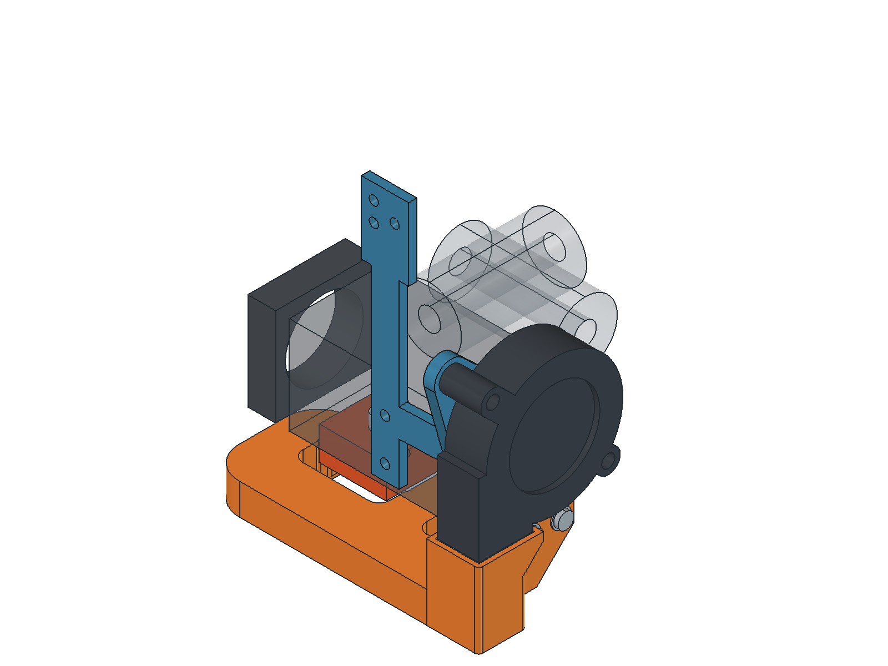

# BIQU H2 adjustable underside O duct and outward-facing 5015

The current assembly is [`output/underside_down/H2_5015_Underside_Down.FCStd`](output/underside_down/H2_5015_Underside_Down.FCStd). Its fan and complete duct can be raised together by **0, 2 or 4 mm**, giving **1, 3 or 5 mm clearance above the nozzle tip**. Two removable spacers set the duct height; the fan slides vertically to maintain the inlet joint. The H2 mounting bracket and separate chain plate stay fixed.

| Assembly lift | Spacer at each duct bolt | Duct screws | Lowest duct above nozzle |
| --- | --- | --- | --- |
| 0 mm (saved assembly) | 4 mm | M3x12 | 1 mm |
| +2 mm | 2 mm | M3x10 | 3 mm |
| +4 mm | None | M3x8 | 5 mm |

Retain **2 mm of washers at each duct screw** in all three settings. Use matching spacers and screw lengths at both mounts, raise the blower by the same amount and reseal its butt joint. Raised jets aim higher, so use the lowest setting that gives sufficient clearance and verify cooling on the printer.

The obstructed lower fan nut now has an open loading channel through the rear support arm. Both nut paths are checked through the full slot travel. The slots are 3.3 x 8.3 mm, with captive sliding nuts and 1.5 mm retaining floors. Their extra 1 mm downward reserve corrects real fan fit; it does not permit lowering the nominal duct below its 1 mm setting.

The outward intake and downward tangent elbow feed a closed O-shaped duct with nominal 7 x 8 mm passages. The fan is 1.7 mm farther forward than the previous revision to clear the rods when raised. The nozzle lips retract 1.5 mm from the heater sock; their nominal aim line remains approximately unchanged. A short rounded internal guide vane supports the wider elbow-blend roof.

| Checked feature | Current adjustable assembly |
| --- | --- |
| Mount-side projection | 10.35 mm; 4.30 mm less than the original right-end design |
| Rightward extension, including hardware | 22.15 mm |
| Rearmost printed point | Y=26.6 mm |
| Blower / bracket clearance to 8 mm rods at nominal height | 4.21 / 3.71 mm |
| Minimum blower rod / heater clearance across the full lift | 2.27 / 2.00 mm |
| Intake | No modeled obstruction in the 10 mm check zone at any height |

Print [`duct_print.stl`](output/underside_down/duct_print.stl) and [`fan_bracket_print.stl`](output/underside_down/fan_bracket_print.stl), plus **two** copies of [`spacer_4mm_print.stl`](output/underside_down/spacer_4mm_print.stl) or [`spacer_2mm_print.stl`](output/underside_down/spacer_2mm_print.stl) for the selected setting. The existing [`chain_plate_print.stl`](output/underside_down/chain_plate_print.stl) is retained. The bracket needs external supports; the duct, chain plate and spacers use supports disabled. See the [printing and height-adjustment guide](output/underside_down/PRINTING.md).

Regenerate with `build_underside_down_duct.py` through FreeCAD MCP, then render with `render_underside_down_duct.py`. Run `verify_underside.ps1 -Variant outward_down` and `python audit_underside_toolpaths.py --variant outward_down` for slicer/path checks. `output/underside_down/adjustable_mount_checks.json` records nut-loading paths, hardware and 17 coupled height positions; `validation.json` and `export_checks.json` record geometry, preservation and watertight exports. The source right-face and inward-facing artifacts remain preserved.

This is a CAD and toolpath-reviewed prototype. Physical fit, stiffness, thermal behavior and cooling require testing. The duct retains slicer alerts documented in the guide; verification G-code is not printer-ready.

## Historical right-end revision

**The sections below describe the preserved previous design. Use the underside files and guide above for the new assembly.**

*Current assembly in situ: one continuous orange duct from the blower to both nozzle outlets, the blue mounting bracket and right-side 5015 blower. The extruder and carriage references are shown translucent.*

The blower is mounted flat against the **right motor end**, with its intake facing right. A combined chain / fan bracket replaces the existing 3 mm chain plate and shares its two H2 M3 holes. The original 3510 heatsink cooling fan stays in place.

The current duct model is `output/monolithic/H2_5015_Monolithic.FCStd`. An assembly copy with the revised vertically adjustable fan bracket is in [`output/right_face/H2_5015_AdjustableMount.FCStd`](output/right_face/H2_5015_AdjustableMount.FCStd); the original duct document and its local edits are preserved. The **entire blower-to-nozzle duct prints as one closed piece**, including the elbow and lower vent. It uses only the **two existing M3 mounting bolts**, washers and bracket nuts. There are no adapter joining bolts, small screws, lid, strap or clips. See the [printing and installation guide](output/monolithic/PRINTING.md) for PETG settings, bridge checks and recorded slicer alerts.

The lower duct retains its **11.2 mm height**, 1.6 mm nominal walls, 14 x 8 mm main passage and smooth tangent bend. Nozzle locations and aim are unchanged. The closed elbow has a continuous sloped ceiling, a flat print base and a 45-degree underside beneath the narrow mounting foot. The old joint ears and split-oriented keel have been removed.

Nine perimeter corners are rounded with **0.8 to 4 mm radii**, including the inner vent turns and the vent-to-elbow/mounting-foot transitions. The [underside view](output/monolithic/bottom.png) shows the smoother outline; the bed face stays flat and the air passage is unchanged.

## Nominal envelope

Coordinates follow the supplied photo: X is left to right, Y points away from the camera, Z is up. The standard nozzle tip is `(14, 1.3, 0)` mm. The H2 body is X=0..61.9, Y=-17.5..17.5, Z=22.2..57.2. The existing heatsink fan extends left to X=-14.9.

| Feature | Size / location |
| --- | --- |
| Fan / motor separation | 4 mm structural frame, no additional air gap |
| Fan + frame extension to right | 19 mm |
| Extension to right including duct socket | 20.9 mm; allow about 22.2 mm including button-head screws and washers |
| Added width on the photo's left | None relative to the existing heatsink fan |
| Extra projection toward camera | 14.65 mm for the continuous duct; fan alone projects 12.7 mm beyond the body |
| Projection away from camera | Frame reaches Y=22.3, about 4.8 mm beyond the body; within the inferred carriage zone |
| Fan outlet height | Z=28 mm; the fan housing reaches approximately Z=79.7 mm |
| Chain mount top | Existing Z=117.7 mm retained |
| Duct outlets | About 32.9 mm2 per channel, centered near Z=3.70 mm, X=1.5 and 26.5, Y=1.3; vertical mouths |
| Jet direction | Nozzle floors and stepped roof envelope follow 15 degrees inward/down; nominal aim is near Z=0.35 at the nozzle |
| Lowest duct surface | 1 mm above nozzle tip |
| Lower duct height | 11.2 mm; main inlet center at Z=6.6 mm |
| Heater / sock gap | At least 2.09 mm to the modeled 24 x 20 x 12 mm envelope |

A 5015 housing is larger than the 35 mm motor end. Some overhang in Y is unavoidable with this orientation. This layout avoids placing the fan's 15 mm depth on the near face and keeps the larger addition on the right as requested. Check the complete printer's travel envelope before homing.

## Fan reference

The interface targets the common two-ear centrifugal 5015 layout, nominally 50 x 50 x 15 mm. The detailed mechanical reference is the manufacturer's [BeCool 5015-1 drawing](https://www.becoolfan.com/uploadfile/202410/7d3269db40767fe.pdf), which shows a 51.6 mm housing outline, 15 mm thickness, and ear coordinates relative to the rotor center. A copy is in `reference/5015-1-drawing.pdf`. The housing here is a simplified reference, not a manufacturing model.

GDSTIME GDB5015 is an example of the usual printer blower format. The [Voron Stealthburner design](https://github.com/VoronDesign/Voron-Stealthburner) is an example of a printer toolhead using a 5015. Housing outlines, ear patterns and outlet lips differ among 5015 suppliers. Before printing the full bracket, compare the selected fan with the drawing and the model: 15 mm thickness, approximately 19.3-19.5 mm outlet width, two ear centers approximately 57 mm apart. The revised mounting slots are vertical: **3 mm down and 1 mm up** from nominal, replacing the former sideways adjustment. The slots are 3.3 mm wide and 7.3 mm long. Both captive-nut recesses follow that travel, with parallel flats to restrain rotation, 2 mm of material around their ends and the existing 1.5 mm retaining floor. This does not accommodate every possible 5015 variant.

The socket opening is 15.6 mm along X and 20 mm along Y. Its top meets the fan outlet as a **butt joint**. With both fan screws loose, slide the blower down to close the observed 1-2 mm gap, then tighten both screws evenly. Stop at the inlet face: the nominal reference already meets the duct, so the full 3 mm downward slot travel is only usable when the real housing leaves that clearance. Use a thin foam gasket or tape around the outside seam; do not push the fan down into the duct. The fan is held by the bracket screws, not by the socket lip.

## Hardware and assembly

- Two M3 screws for the H2, nominally M3x8 as used with the original 3 mm chain plate. Reuse the existing screws if engagement is suitable.
- Two M3x20 button-head screws for the fan, with about **1.5 mm of washers under each head**, and two M3 hex nuts. Use washers with enough outside diameter to span the blower's approximately 4.7 mm ear holes.
- Two M3x10 button-head screws for the duct, about 0.5 mm washers, and two M3 hex nuts.
- The complete duct is one print and requires **no joining hardware**. The two M3 mounting bolts above are its only fixings. See the [installation guide](output/monolithic/PRINTING.md).

All four fan/duct nuts load from the **motor-facing side** of the right frame. Recesses are 2.5 mm deep with approximately 5.75 mm across flats. The fan recesses are elongated to preserve the slot adjustment. The fan recesses leave 1.5 mm of plastic between the nut and fan face. The duct recesses leave 3.5 mm between nut and duct mounting face.

1. Fit the four nuts into the rear recesses. Check the real nut fit before mounting the bracket.
2. Replace the existing chain plate with the combined bracket and refit the chain. The source SCAD's 15 mm H2 spacing, chain-hole positions and 69 mm distance between hole-group centers are retained. The comment saying 59 mm conflicts with the SCAD geometry; the geometry was followed. The original rounded union blend is omitted.
3. Mount the blower on the right frame, intake pointing right, outlet pointing down. Use the specified washer stack so screw ends stop inside the frame instead of projecting into the motor. Check actual screw lengths and washer thicknesses during assembly.
4. Inspect the single duct print and fit its two-bolt mounting foot using the installation guide. The inlet meets the blower outlet. Fit the gasket around that butt joint and tighten the two M3 mounting bolts.
5. With the printer cool and powered down, check the heater sock, nozzle, motor plug, wires, rods and full carriage travel. The tips should remain above the nozzle plane. Adjust the CAD if the real sock or nozzle differs from the reference.

The old part-cooling fan and its mounting duct are replaced. Do not remove the stock heatsink cooling fan.

## Printing and verification

This is a **CAD and toolpath-reviewed prototype**, not a physically tested airflow design. The complete duct prints upright on its flat base. The lower manifold retains its two-layer roof stagger and approximately 14 mm bridges; the nozzle roofs retain approximately 10 mm bridges and 0.2 mm treads. The elbow ceiling and outer mounting-foot support are shaped for this upright orientation.

For PETG, use `output/monolithic/duct_print.stl` in its supplied orientation, with supports disabled, 0.2 mm layers and a 0.4 mm nozzle. Verification uses Arachne, four perimeters, 20% infill and a 3 mm brim. SuperSlicer retains stability/loose-extrusion alerts, documented in the guide and logs; the rounded revision no longer produces the previous floating-region alert. The CAD bridge and toolpath-anchor checks pass, but PETG sag, adhesion, fit and airflow still require physical testing. The separate mounting bracket still needs supports.

`output/monolithic/validation.json` records one valid solid, one connected air route with exactly three openings, zero air blockage, no modeled reference collisions and fit for the existing mount hardware. The STL is watertight and the STEP reopens as one valid solid. The facet audit finds no non-flat downward area beyond the 45-degree criterion. Rod and bearing positions were inferred from `croxy_carriage_h2_touch_less_offset.scad`, with an assumed 8 mm rod diameter; the heater sock, plug, wiring and carriage remain simplified references.

## Files and regeneration

- `output/monolithic/H2_5015_Monolithic.FCStd`: current single-print duct and installed reference layout.
- `output/monolithic/duct_print.stl`: the complete current duct, seated on Z=0 for upright printing.
- `output/monolithic/duct_assembled.step`: the full duct at installed coordinates, without reference hardware.
- `output/monolithic/PRINTING.md`: PETG printing and installation guide, including a cutaway illustration.
- `output/right_face/h2_5015_right_bracket.stl`: the existing mounting bracket, including chain mount.
- `output/right_face/H2_5015_AdjustableMount.FCStd`: current duct with the vertically adjustable fan bracket, saved as a separate assembly.
- `output/right_face/adjustable_mount_checks.json` and `verify_adjustable_mount.py`: manufacturing mesh/STEP checks, screw and nut clearance at nine positions per slot, fan clearance at both travel limits, and current duct compatibility. Run the verifier after regenerating the right-face bracket; it preserves the original monolithic document.
- `build_monolithic_duct.py` and `render_monolithic_duct.py`: regenerate geometry and views via the FreeCAD MCP `execute_python_file` tool.
- `verify_monolithic.ps1`: repeat support-disabled slicing; `-FailOnWarnings` treats retained alerts as failures. Verification G-code is not printer-ready.
- `audit_monolithic_bridges.py` (FreeCAD) and `audit_monolithic_toolpaths.py` (ordinary Python): repeat CAD bridge and preceding-toolpath anchor checks.
- `output/one_piece/`, `output/support_free/` and `output/printable/`: earlier multipart alternatives, retained for reference.
- `build_h2_5015_right.py` and `right_face_parameters.json`: generate the reference mounting bracket and fan layout. Some H2 datums and routing stations are fixed in the scripts.

H2 dimensions were read from BIQU's original manufacturer drawing [mirrored here](https://meltbro.de/images/product_images/original_images/Ha3e48c4557434aab986f21c8810ed609K.png), saved as `reference/H2-dimensions.png`, and checked against the user's carriage SCAD. The supplied chain SCAD was read as geometry reference and left unchanged.
