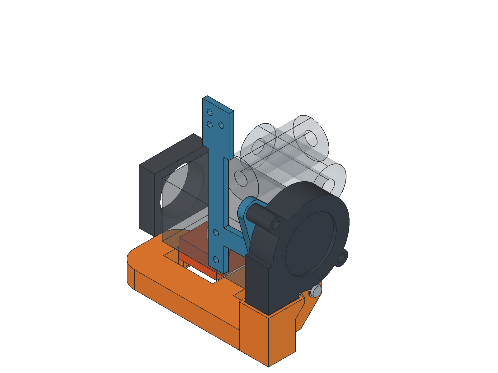
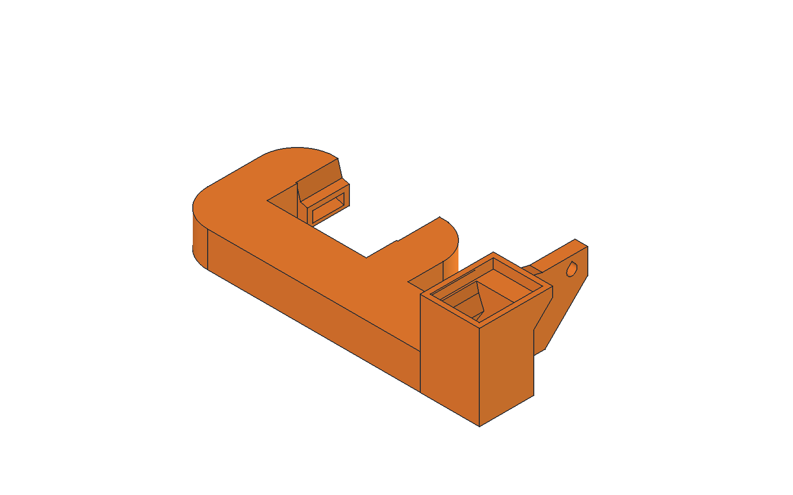
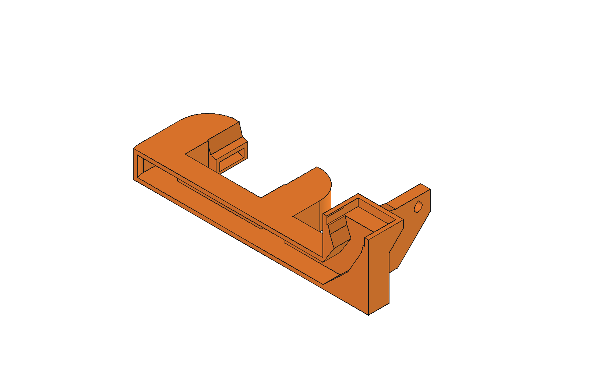

# Single-print blower-to-nozzle duct

Print **`duct_print.stl` only** for the complete orange duct. It includes the blower inlet, closed elbow, slim lower manifold and both nozzle outlets in one solid. There are no adapter halves, lid, strap, clips, joining bolts or tapped plastic holes. The blue fan/chain mounting bracket remains a separate existing part.

## PETG printing

Use the supplied flat-bottom orientation, a calibrated PETG profile, **0.2 mm fixed layers**, a 0.4 mm nozzle, four perimeters and 20% infill. Verification uses a 3 mm brim and supports disabled. The mesh is approximately **97.7 x 45.15 x 27 mm**. Generate printer-ready G-code with your own temperatures, cooling and bridge settings.

The lower duct keeps its 11.2 mm height, 14 x 8 mm main passage, 7.6 mm side-arm height and smooth tangent bend. Its side-arm roofs close two layers before the transverse manifold, allowing short bridge directions across each channel. The manifold bridges about 14 mm; nozzle ceilings bridge about 10 mm and retain their 0.2 mm treads.

The elbow uses its continuous sloped internal ceiling. The new outer base and 45-degree mounting-foot underside support upright printing; the former split-oriented keel, joint ears and retaining collar are removed. Mounting holes have upward teardrop roofs. The facet audit finds zero non-flat downward area beyond the 45-degree criterion. Flat downward faces remain deliberate bridges.

The cutaway has a wall removed **for illustration only**. The STL and manufacturing STEP are closed parts. Do not print internal supports that cannot be removed through the inlet and outlets. Inspect those openings for strings and bridge sag before installation.

## Hardware and installation

The complete duct uses **only the two existing M3x10 button-head mounting bolts**, approximately 0.5 mm washers and the bracket's M3 captive nuts. The fan and H2/chain bracket keep their existing hardware. No extra bolts or nuts join duct parts.

1. Inspect and clean the single print, including the closed elbow and both outlets. Check that the mounting bolts and washers fit, and that the air route is clear.
2. Fit the duct to the existing right-side bracket with the two M3 mounting bolts. Check actual bolt length and engagement before tightening. The reference bolt/washer models in FreeCAD are excluded from the STL and STEP.
3. Bring the blower outlet to the duct inlet as a butt joint at Z=28 mm. Seal the outside of that seam with thin foam or tape if needed. There is no adapter split or adapter-to-lower-duct seam to seal.
4. On the cool printer, check the heater sock, nozzle, wiring and full carriage travel. Modeled heater clearance is about 2.10 mm; the lowest duct surface stays 1 mm above the nozzle datum. The duct projects 20.9 mm to the right of the H2 body and 14.65 mm toward the camera beyond the body.

Use this complete single print in place of the previous three duct parts. The existing mounting bracket is unchanged. Previous `output/one_piece`, `output/support_free` and `output/printable` designs remain historical alternatives.

## Verification and limitations

`validation.json` records one valid solid, one connected air volume and exactly three openings, zero air blockage, zero modeled reference collisions and clearance for the existing mounting bolts and washers. `export_checks.json` records a watertight STL with zero nonmanifold edges and a STEP file that reopens as one valid solid.

Support-disabled slicing with SuperSlicer 2.7.62.0, Arachne, 0.2 mm layers and a 0.4 mm nozzle succeeds, but retains **Floating object part / Collapsing overhang / Loose extrusions** alerts in `slice_checks/duct.log`. These alerts are not suppressed. This remains a CAD and slicer-reviewed prototype requiring a physical PETG print and airflow test.

`slice_checks/duct_bridge_audit.json` samples the preceding CAD layer at 0.15 mm intervals on sections approximated to 0.02 mm. All 281 manifold-roof bridge paths have supported ends, independently checked against the exact solid. Their longest unsupported run is approximately 14.0 mm. The audit also samples the elbow's perimeter paths and records source hashes.

`slice_checks/toolpath_anchor_audit.json` checks all 4,501 continuous extrusion runs above the first layer. Each has a sampled point within 0.48 mm of a preceding-layer extrusion centerline. This finds a nearby anchor; it does **not** prove that every portion of a run is supported, or predict PETG sag, adhesion or cooling.

Regenerate through `build_monolithic_duct.py` in FreeCAD, slice with `verify_monolithic.ps1`, run `audit_monolithic_bridges.py` through FreeCAD and `audit_monolithic_toolpaths.py` with ordinary Python. `verify_monolithic.ps1 -FailOnWarnings` treats the retained slicer alerts as failures. The ignored verification G-code has no heating or homing sequence and is not printer-ready.

`H2_5015_Monolithic.FCStd` contains the installed duct, existing mount hardware references, a hidden bed-oriented copy and an illustrative cutaway. The manufacturing STEP and STL contain the full duct only.
