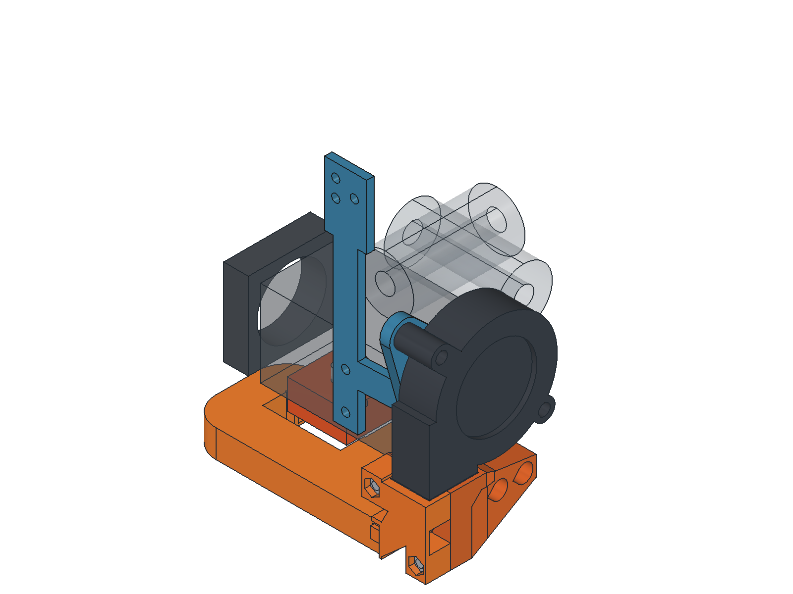
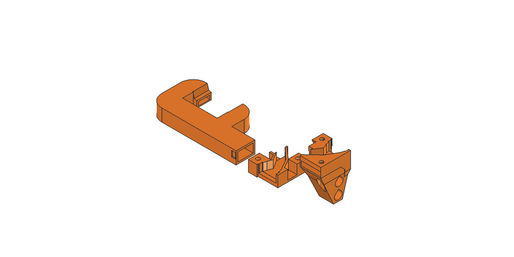
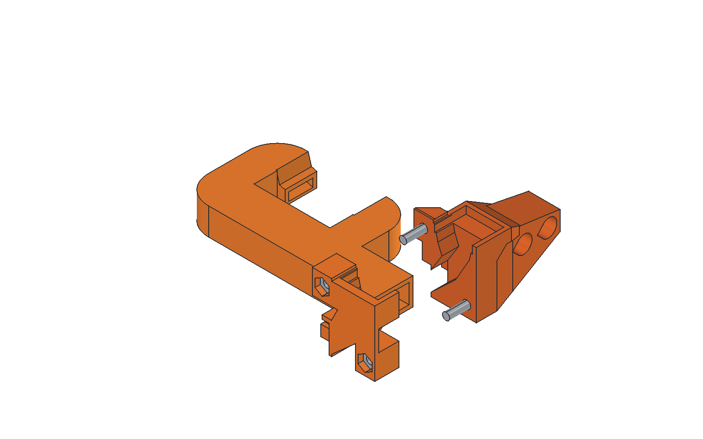

# One-piece lower duct and two-bolt adapter

Print all three matching `*_print.stl` files in this folder. The lower U-shaped duct includes its roof and both nozzle roofs in one solid. The adapter stays in two halves for cavity access and support-free orientation. Two M3 bolts close those halves around retaining keys on the lower duct. No small screws, tapped plastic holes or flexible clips are required.

The slim revision reduces lower-duct height from **15 to 11.2 mm**, using 1.6 mm floor and manifold roof thicknesses. The main passage remains 14 x 8 mm, with its center lowered from Z=8 to Z=6.6 mm. Nozzle locations and aim are retained. The far-end bend is now tangent to the straight manifold, eliminating its 2 mm square shoulder. Lower-duct CAD volume falls from 16.43 to 9.51 cm3, approximately 42%; actual filament use depends on slicing.

Use the **complete slim set**. Its adapter outlet, supporting keel and roof strap match the lowered duct. Earlier one-piece adapter prints have a different outlet height and are not matching parts.

## PETG printing

| Part | Supplied bed orientation | Bridge features |
| --- | --- | --- |
| `lower_duct_print.stl` | Broad flat bottom down | 14 mm transverse manifold, approximately 10 mm side arms/nozzle roofs, small retaining-pocket roofs |
| `adapter_front_print.stl` | Flat outer back down; cavity up | M3 nut-pocket closures and small key features |
| `adapter_back_print.stl` | Mounting foot down; cavity up | M3 head-recess closures and small key features |

Start with a calibrated PETG profile, a 0.4 mm nozzle, **0.2 mm fixed layers**, four perimeters, 20% infill and supports disabled. A 3 mm brim helps the taller rear adapter. Use the supplied orientations and automatic bridge direction. Tune bridge speed, flow and cooling for your PETG; no temperature or cooling values from the geometry-verification G-code should be used as a print profile.

The side-arm internal roofs are 0.4 mm lower than the transverse manifold roof. At the verified 0.2 mm layer height, they close two layers earlier. This separates the U-shaped ceiling into bridge regions with different directions. A uniform-height ceiling made the slicer attempt long bridges along the arms. The transverse passage remains 14 x 8 mm and the side arms have 7.6 mm internal height. Nozzle ceilings retain their 0.2 mm treads and their 10 mm clear spans.

This is a CAD and slicer-reviewed PETG prototype. Physical bridge quality, hardware fit, heat resistance and airflow still need checking on the actual printer. The closed lower duct cannot be opened for cleaning, so inspect both outlets and the inlet for strings or sag before assembly. Do not enable internal supports that cannot be removed.

## Hardware

- **Two M3x10 socket-head bolts** for the adapter halves, with heads approximately 5.5 mm in diameter and 3 mm high. No washers at these two joints.
- **Two ordinary M3 hex nuts**, nominally 5.5 mm across flats and 2.4 mm thick. Nut pockets are 5.8 mm across flats; shaft holes are 3.4 mm diameter.
- Retain the existing **two M3x10 button-head mounting bolts**, approximately 0.5 mm washers and bracket captive nuts for the adapter-to-bracket mount.
- Retain the fan and H2 bracket fasteners described in the repository README.

The two new bolts are the only fasteners joining the three printed duct parts. The two existing adapter-to-bracket mounting bolts are additional. All seven M2 fasteners from the previous four-section duct are eliminated.

## Assembly

1. Clean and inspect the three prints. Check that actual nuts seat flat in the front half's two accessible hex pockets, and that the bolt heads fit the rear recesses. Do not substitute longer bolts without checking the resulting projection.
2. Assemble **on the bench before mounting to the extruder**. Place the lower duct's inlet between the two adapter halves. Each half's short retaining tooth enters the matching closed pocket on the outside of the lower duct. The roof strap sits above the integral duct roof, and the end stop meets the inlet face. The keys have 0.25 mm nominal clearance; they capture the duct without bending a clip.
3. Load the two M3 nuts into the front half's hex pockets. Insert the two M3x10 bolts from the rear half's recessed head side and tighten gently. Hold the upper bolt head while the assembly is off the extruder, as installed access is restricted by the H2 body. The halves must meet without forcing the keys; remove print burrs if needed.
4. Check that the lower duct cannot pull out or lift away from the closed adapter. The two bolts clamp the adapter halves; the molded keys retain the lower duct. The strap requires no screw.
5. Seal the outside adapter split and adapter-to-duct seam with thin removable foil tape if needed. Keep sealing material out of the air passage. Mount the complete duct with the two existing M3 mounting bolts, and seal the blower butt joint externally.
6. On the cool printer, check the heater sock, wires, nozzle plane and full carriage travel. The modeled duct stays 1 mm above the nozzle datum with about 2.10 mm heater clearance. Verify actual clearance before heating.

## Recorded checks

`validation.json` checks three valid single solids, one connected air volume and exactly three openings, zero air blockage, zero part overlap, modeled hardware fit and reference clearances. Separating the adapter halves along Y is checked at seven offsets; a separate displacement check confirms the closed adapter retains the lower duct.

`export_checks.json` records watertight STL files, zero nonmanifold edges and valid single-solid STEP reimports. There is zero non-flat downward mesh area steeper than 45 degrees in the supplied orientations. Flat downward faces are deliberate bridges, not proof of physical print success.

All three parts were sliced with supports disabled using SuperSlicer 2.7.62.0, Arachne, 0.2 mm layers and a 0.4 mm nozzle. Each retains a stability alert containing **Collapsing overhang / Loose extrusions**. The lower duct's initial **Long bridging extrusions** alert disappeared after the roof step was added. The alerts remain in `slice_checks/*.log` and `slice_validation.json`; inspect your own slicer preview before printing.

`slice_checks/lower_duct_bridge_audit.json` records 282 manifold-roof bridge extrusion segments at print heights 9.4 and 9.8 mm. Every segment has both ends on the preceding CAD layer. At 0.15 mm sample spacing on CAD sections discretized to 0.02 mm, the longest unsupported run is approximately **14.0 mm**; the longest complete extrusion including its supported ends is 15.64 mm. The audit records source hashes for the STL and verification G-code. CAD support sampling does not predict PETG sag or actual infill adhesion.

Run `verify_one_piece.ps1` from the repository root to repeat slicing; `-FailOnWarnings` treats the retained alerts as failures. Run `audit_one_piece_bridges.py` through FreeCAD afterward to measure bridge paths against the prior CAD layer. The ignored `*verification.gcode` files have no heating or homing sequence and are geometry checks only. Generate printer-ready G-code with your own PETG profile.

`H2_5015_OnePiece.FCStd` contains the installed assembly, reference M3 joint hardware and hidden bed-oriented copies. STEP files use installed coordinates and include printed parts only. Earlier `support_free` and `printable` files are historical alternatives, not matching parts for this revision.
