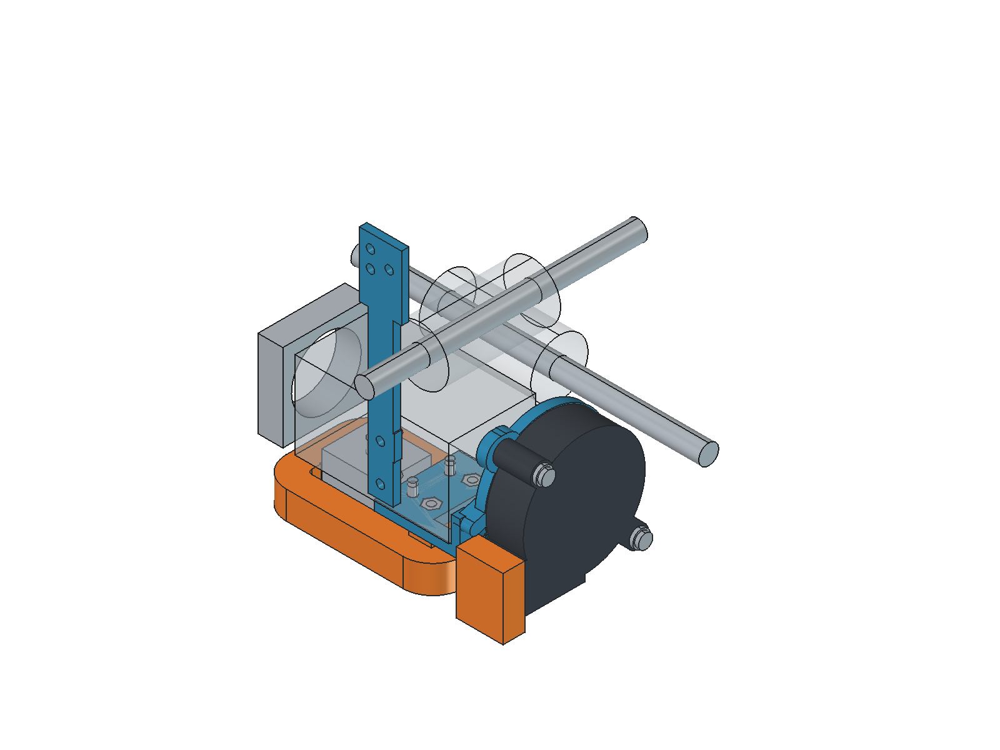
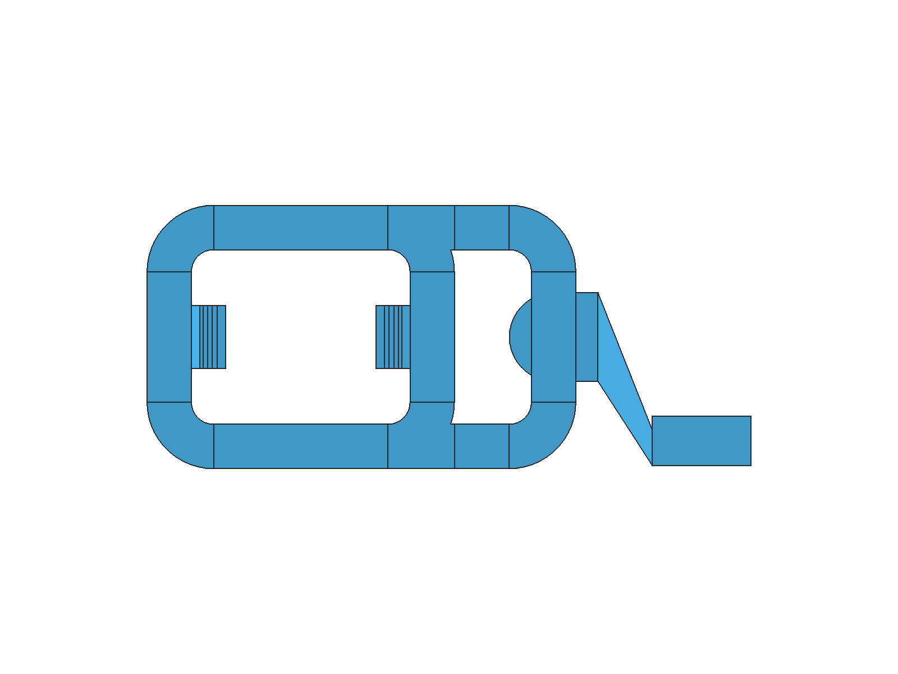
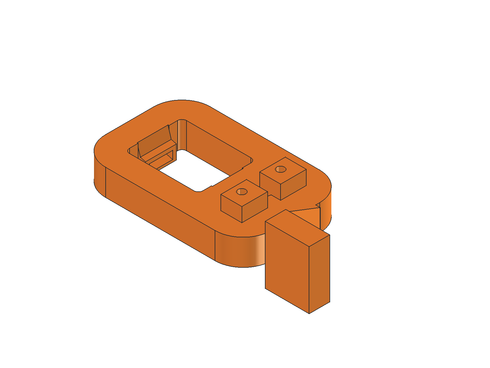
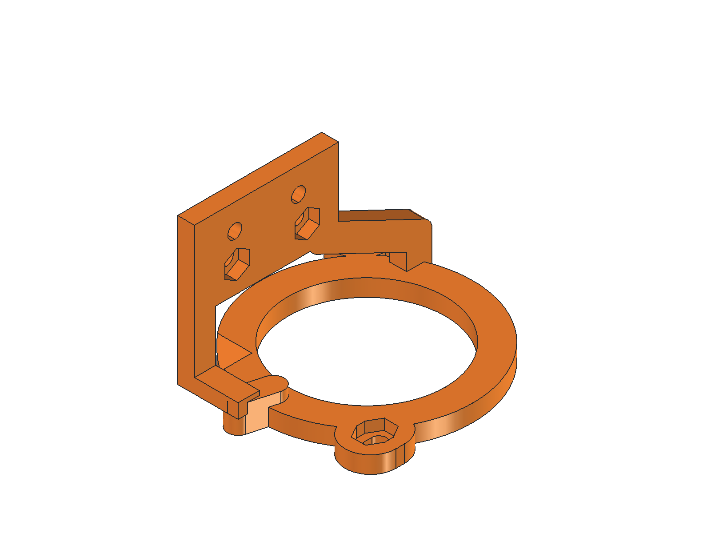
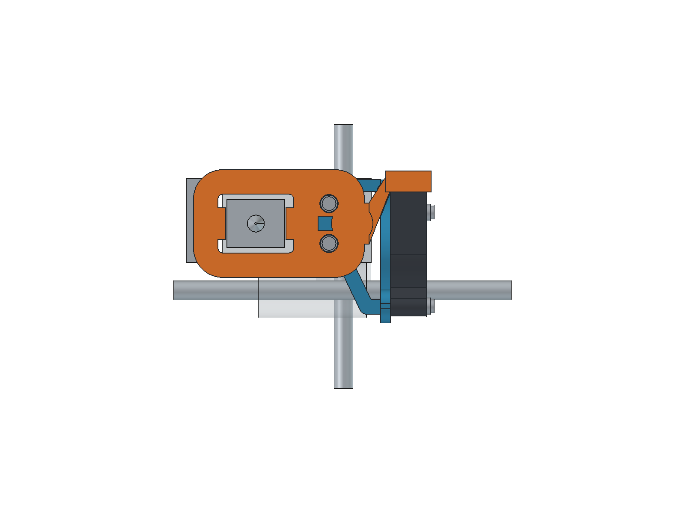
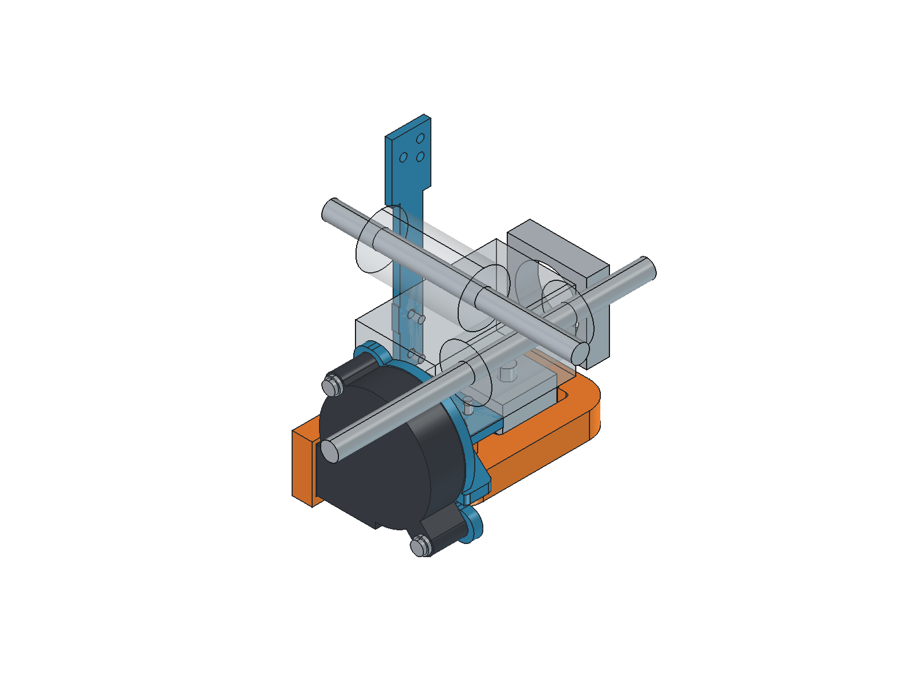

# Underside O duct and inward-facing 5015

Use `H2_5015_Underside.FCStd` for the installed assembly. STL files contain only their named printable part, already oriented and seated on Z=0. STEP files retain installed coordinates. The old right-face bracket and duct are superseded for this layout; their files remain unchanged.

## What changed

The 5015 is flipped so its intake faces the H2 motor, rotated to discharge horizontally toward -Y, shifted 17 mm toward the rear rod, lowered 22 mm, and moved 4 mm farther right than the previous fan. The intake plane is 8 mm from the motor-end plane. An open 37 mm bracket window leaves the modeled 32.5 mm intake unobstructed.

The lower duct forms an O around the heater with two rounded feed legs. The nominal channels are 7 x 8 mm internally; straight vertical legs close 0.4 mm earlier and corner panels close 0.2 mm earlier to help the slicer bridge across their width. The same two nozzle mouths are retained at X=1.5/26.5, Y=1.3, centered near Z=3.70 mm, aimed 15 degrees inward/down. Nominal walls are 1.6 mm and the bottom is 1 mm above the nozzle tip.

Mount-side projection is 3.60 mm versus 14.65 mm previously, a modeled recovery of 11.05 mm. Allow 26.15 mm to the right of the H2 including fan screw heads and washers. The rear bracket reaches Y=42.6 mm, 2.1 mm past the simplified carriage envelope. Check both ends of travel on the actual printer; this CAD does not include the complete frame, bed clips, probe, belts or wiring.

## Parts and print orientation

| File | Orientation | Supports |
| --- | --- | --- |
| `duct_print.stl` | Supplied broad flat base down | Disabled; internal supports cannot be removed |
| `fan_bracket_print.stl` | Supplied fan-facing plane down | External supports from the build plate |
| `chain_plate_print.stl` | Supplied broad side down | Disabled |

Use a calibrated PETG profile, 0.2 mm fixed layers, 0.4 mm nozzle, four perimeters, **100% rectilinear infill for the duct and thin chain plate**, 20% infill for the supported fan bracket, and a 3 mm brim as the verification baseline. Solid infill avoids isolated top-surface fragments over sparse infill in the mounting pads. Tune temperatures, cooling and bridge flow for the actual filament. Keep supports out of the duct. Clear strings and inspect the inlet and both outlets before fitting.

The two duct fixing holes each have a **0.2 mm sacrificial membrane** at the top of the underside counterbore. This gives its ceiling one continuous short bridge instead of isolated strands around the screw hole. Pierce/clear both membranes to 3.3 mm before assembly. They are present in the manufacturing STEP and STL; the installed `Duct` object and hardware checks represent the prepared holes.

The fan bracket has accessible support surfaces and no closed air passage. Remove supports from its arms, mounting pad, screw slots, nut pockets and intake window. Load its four captive nuts before fitting it to the H2.

## Hardware

All quantities below are for the new fan/duct assembly. The chain plate reuses the original H2 side screws and chain hardware.

| Location | Hardware |
| --- | --- |
| Bracket to H2 underside | 2 x M3x8 button-head screws, each with approximately 0.5 mm washer |
| Duct to underside bracket | 2 x M3x12 button-head screws, each with **2 mm total washers**, and 2 x M3 hex nuts |
| Blower to bracket | 2 x M3x20 button-head screws, each with **1.5 mm total washers**, and 2 x M3 hex nuts |

Use washers wide enough to span the fan ear holes. Duct nuts load from the top of the H2 mounting pad; fan nuts load from the motor-facing side of the fan frame. Pockets are approximately 5.75 mm across flats, 2.5 mm deep, with 1.5 mm retaining floors. Check real nut fit.

The washer stacks are functional: they stop screw ends protruding into the H2 or motor. The nominal M3x8 underside screws engage 3.5 mm into the H2. The duct screws stop flush with the mounting pad's top plane. Verify actual hole depth, screw length and head/washer dimensions before tightening; the reference H2 underside threads are nominal geometry, not measured threads.

## Installation

1. With the printer cool, verify the two underside M3 positions: **X=37.4, Y=+/-7.5 mm**, on the Z=22.2 underside plane. This nominal pattern follows the supplied carriage SCAD's top/bottom H2 fixing pattern. Confirm the real H2 variant, usable thread depth and wire routing. Do not drill or force a mismatched pattern.
2. Replace the old combined fan/chain bracket with `chain_plate_print.stl`, retaining the original chain positions and side fixings.
3. Insert all four captive nuts into the underside fan bracket. Fit the bracket beneath the cool H2 body with the two M3x8 screws and 0.5 mm washers. Leave the motor connector and its cable clear. These H2 screws are reached before fitting the duct.
4. Install the blower with its intake facing the motor, its outlet toward -Y, using the M3x20 screws and 1.5 mm washer stacks. The modeled intake gap is 8 mm; do not fill it with foam, wiring or a cover.
5. Pierce the two thin screw-hole membranes and clear them to 3.3 mm. Fit the single duct under the bracket using the two M3x12 screws, 2 mm washer stacks and captive nuts. The screw heads are reached through the two underside counterbores.
6. Align the horizontal fan outlet with the duct inlet. The two fan slots provide +/-1 mm of Y adjustment, with matching nut travel. **Stop at the seam**: the nominal fan already meets the inlet, so full bracket travel is only available when the real fan leaves a gap. Seal the outside of the butt joint with thin tape or a gasket; do not push the housing into the duct.
7. Check the real heater/sock, nozzle access, fan intake, connector, wires, probe and full carriage travel. CAD clearances are about 2.10 mm to the simplified heater/sock, 2.74 mm from blower to rods, and 2.24 mm from bracket to rods. The fan itself is 4.6 mm above the nozzle plane. Inspect again at operating temperature before relying on the assembly.

## Verification and limits

`validation.json` checks three valid single-solid print parts; one connected air volume with exactly three intended openings; zero modeled reference, inter-part, hardware, air-route and intake obstruction volumes; and source-file preservation. Both fan slots and their nuts are checked at nine positions, and fan/reference clearance is checked at both slot limits. The source adjustable and monolithic revisions are preserved.

`export_checks.json` verifies watertight STLs with zero nonmanifold edges and STEP reimports as valid single solids. The duct has no non-flat unsupported exterior facets beyond 45 degrees; flat internal roofs remain deliberate bridges. The fan bracket requires supports.

`verify_underside.ps1` runs SuperSlicer 2.7.62.0 with Arachne, the print settings above, supports disabled for duct/chain and build-plate supports for the fan bracket. Logs and `slice_validation.json` retain all warnings; `-FailOnWarnings` treats them as failures. `audit_underside_toolpaths.py` checks actual extrusion anchors against the preceding layer and measures tagged bridge spans. The verification G-code omits temperatures and homing and is **not printer-ready**.

The final recorded slice succeeds for all three parts. The fan bracket and chain plate have no slicer warnings. The duct retains **Collapsing overhang / Loose extrusions** alerts; the former long-bridge alert is gone. The toolpath audit checks **3,777 duct runs and 540 chain-plate runs**, with no unanchored runs, no runs relying only on earlier same-layer paths, and a maximum measured bridge gap of **15.14 mm**. The checked STL and G-code hashes are recorded in `slice_checks/toolpath_anchor_audit.json`. These are geometric checks, not a PETG print test.

This is a CAD and slicer-reviewed prototype. The body, fan, heater/sock, motor plug, carriage and rods remain simplified references. The 8 mm intake gap is not a demonstrated airflow guarantee. Narrower channels, the intake restriction and the differing paths to the two nozzle mouths can affect total flow and balance. Test both outlets, cooling performance, PETG bridge sag, mounting stiffness and thermal creep on the physical printer before treating it as a proven design.
