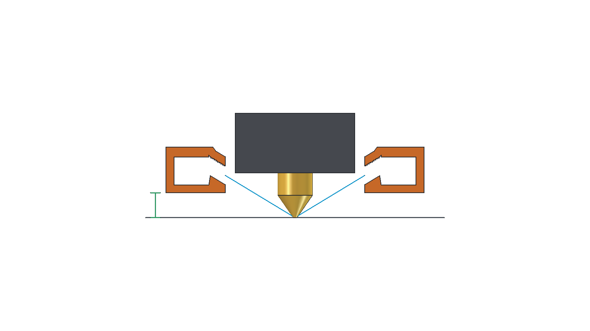
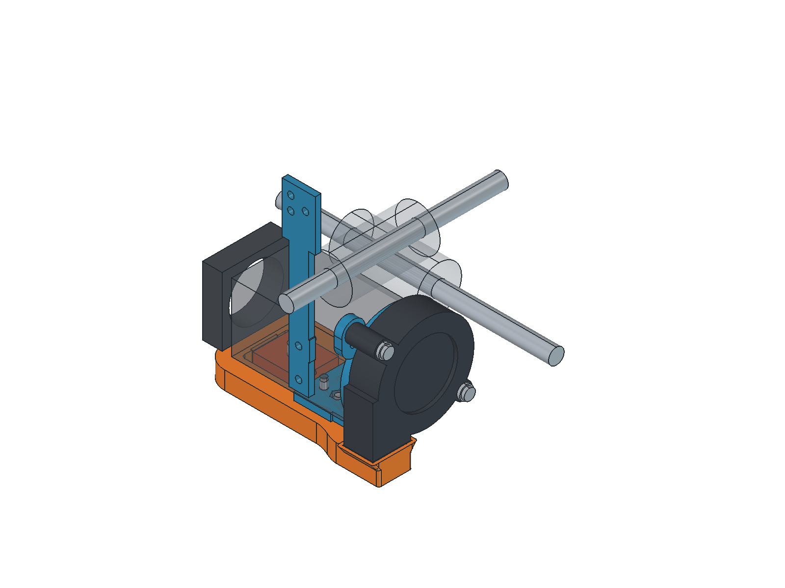
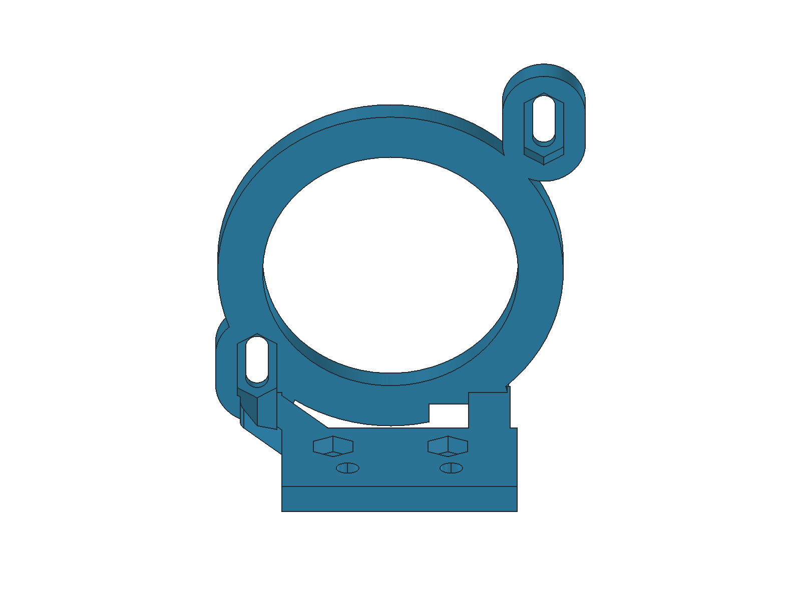

# Elevated slim underside O duct and outward-facing 5015

Open `H2_5015_Underside_Down.FCStd`. The saved assembly uses two 4 mm spacers, giving the duct 5 mm clearance above the nozzle tip. The complete duct and blower can rise together by 2 or 4 mm. The H2 bracket and chain plate stay fixed.

## Choose the height

| Assembly lift | Spacer at each duct mount | Duct screws | Duct clearance above nozzle |
| --- | --- | --- | --- |
| 0 mm (recommended) | 4 mm | 2 x M3x12 | 5 mm |
| +2 mm | 2 mm | 2 x M3x10 | 7 mm |
| +4 mm | None | 2 x M3x8 | 9 mm |

Use **2 mm total washers under each duct screw head** at every setting. Print two identical spacers of the selected thickness. Do not mix thicknesses, stack spacers beyond 4 mm, or keep the long screws when raising the duct: the matched lengths keep their tips at Z=22.2 mm and clear the H2 body.

The fan slots provide -1 to +4 mm vertical travel. Raise the fan by exactly the same amount as the duct, close the inlet seam gently and retighten both fan screws. The -1 mm reserve only accommodates real housing variation at the seam. Do not force the fan into the duct or lower the nominal duct below its 5 mm setting.

Use the saved 0 mm lift setting for the intended aim. The internal outlet lands angle down by 31.3 degrees and geometrically target the nozzle-tip plane. Extra lift raises that target by 2 or 4 mm and can direct part of the jet onto the heater sock; test cooling if using it. Nozzle-tip clearance equals bed clearance only when the nozzle tip is at the bed datum; add the current layer height in normal use.

Cyan lines show geometric axes, not CFD results.

## Nut access and fit

The fan nut channels pass through the rear support arm, retaining the 1.5 mm floor toward the fan. Both elongated nut pockets have 5.75 mm across-flat loading clearance, parallel flats and a clear 11.9 mm approach from the motor-facing side. Fit the nuts before installing the bracket/fan; the check covers insertion geometry, not finger/tool ergonomics on every printer.

The fan center is Y=1.3, Z=41.8 mm at nominal height, with its outlet at Z=16 mm. Its back remains 4 mm from the H2 motor end. The modeled fan has at least 2.27 mm rod clearance at maximum lift. The fixed bracket has relief around the rising elbow.

The O manifold has nominal 7 x 6 mm air passages, 1.6 mm walls, staggered roofs and the tangent elbow. The ring is 9.2 mm deep rather than 11.2 mm, and the whole duct is 11 mm tall rather than 15 mm. Modeled material volume falls 12.6%; the X/Y footprint is retained. Its 8 mm return blend and six 1.2 mm inlet corner rounds remain. A rounded 1.2 mm internal vane turns toward the elbow to anchor its roof. Air remains connected around the vane ends. A local roof recess clears the motor connector through all 4 mm of lift, retaining 0.2 mm vertical connector clearance at maximum lift. The lowered portion has 3.8 mm air height; an adjacent strip remains taller. The reduced passages may increase pressure loss; airflow rate and balance are untested.

The opposed mouths are now X=0 and 28, Y=1.3, centered near Z=8.51 mm at nominal height. Their 3 mm internal lands aim inward and down at 31.3 degrees and maintain **at least 2 mm clearance to the modeled heater sock throughout adjustment**. The nominal heater gap is 2.0 mm. Each outlet has about 32.2 mm² projected flow area, versus 32.9 mm² previously. Actual socks, wiring and fan housings vary.

Mount-side projection is 10.35 mm, rightward extension including hardware is 22.15 mm, and the rearmost printed point is Y=26.6 mm. At nominal height the blower/bracket rod gaps are 4.21/3.71 mm. The intake has an unobstructed modeled 32.5 mm diameter, 10 mm deep check zone at all heights; this is not a manufacturer clearance specification.

## Print files

| File | Quantity | Orientation / supports |
| --- | --- | --- |
| `duct_print.stl` | 1 | Broad flat base down; supports disabled |
| `fan_bracket_print.stl` | 1 | Fan-facing plane down; external supports from bed |
| `chain_plate_print.stl` | 1, or retain existing | Broad side down; supports disabled |
| `spacer_4mm_print.stl` | 2 for nominal height | Flat down; supports disabled |
| `spacer_2mm_print.stl` | 2 for +2 mm height | Flat down; supports disabled |

No spacers are used at +4 mm. The supplied spacer STLs contain **one spacer each**.

The PETG verification baseline uses a 0.4 mm nozzle, 0.2 mm fixed layers, four perimeters, Arachne and a 3 mm brim. Use 100% rectilinear fill for the duct, chain plate and spacers; 20% for the bracket. Keep supports out of the closed duct. Inspect the air route for strings and bridge sag.

The duct bolt counterbores have 0.2 mm sacrificial membranes. Pierce/clear them to 3.3 mm before assembly. Exported STL/STEP files include these membranes; the installed `Duct` object represents prepared holes.

## Hardware and installation

| Location | Hardware |
| --- | --- |
| Bracket to H2 underside | 2 x M3x8 button heads, approximately 0.5 mm washers |
| Duct to bracket | Matched M3x12/x10/x8 screws from the height table, 2 mm washer stacks, 2 x M3 nuts |
| Fan to bracket | 2 x M3x20 button heads, 1.5 mm washer stacks, 2 x M3 nuts |
| Chain plate | Retain original side screws and chain hardware |

1. With the printer cool, confirm the H2 underside M3 pattern: X=37.4, Y=+/-7.5, Z=22.2 mm. This follows the supplied carriage SCAD. Check actual hole depths; nominal H2 screw engagement is 3.5 mm.
2. Fit the separate chain plate. Insert the two duct nuts from the top of the mounting pad and two fan nuts from the motor-facing channels. Check nut fit, clear support material, then install the bracket beneath the H2. Leave the connector and wires clear.
3. Fit the fan with its intake outward and outlet down, using the specified M3x20 screws and 1.5 mm washer stacks. Leave its screws loose for alignment.
4. Clear the duct screw membranes. Fit matching spacers between the duct bosses and bracket underside, and use the corresponding screw length with 2 mm washers. At +4 mm the duct bosses contact the bracket directly. Reach the heads through the underside counterbores and tighten evenly.
5. Move the blower up by the selected lift. Its outlet must meet the duct inlet without pressing into it. Tighten both fan screws and seal around the butt joint with thin tape or an appropriate gasket. Confirm actual screw-tip clearance and clamp engagement.
6. Check sock, nozzle, probe, wires, rods and full carriage travel. Confirm the selected duct clearance on the real printer, then test stiffness, thermal behavior and cooling.

To change height later, support the duct, loosen both fan screws, remove the two duct screws and replace/remove both spacers. Refit the correct screws, align the fan to the new inlet height and reseal the seam.

## Verification

`validation.json` checks valid single-solid prints, one air route with three openings, zero reference/hardware/inter-part overlap, zero air/intake blockage and build-input hashes. `adjustable_mount_checks.json` adds 42 nut-loading positions and 17 coupled heights, including spacers, shortened duct screws, fan hardware, fixed references and inlet alignment. Minimum heater/rod clearances are 2.00/2.27 mm.

`export_checks.json` records all five STL files as watertight with zero nonmanifold edges, and all STEP files reopening as valid single solids. The duct has no non-flat downward facets beyond the 45-degree limit; the bracket needs external supports.

SuperSlicer 2.7.62.0 completes all five parts. The duct retains bridge/loose-extrusion alerts; the bracket, chain plate and spacers have no slicer warnings. Inspect these alerts and the generated paths before printing. The updated path audit checks 2,901 duct runs, 534 chain-plate runs and 244 spacer runs, with no unanchored runs or runs relying only on earlier same-layer paths. The longest measured bridge is **12.46 mm**. `slice_checks/toolpath_anchor_audit.json` records checked STL/G-code hashes, extrusion anchors and bridge spans. Verification G-code omits heating/homing and is **not printer-ready**.

Regenerate in FreeCAD with `build_underside_down_duct.py`, `render_underside_down_duct.py` and `render_clearance_review.py`. The builder invokes `verify_underside_down_adjustment.py` before exporting; that verifier can also check the saved assembly independently. Slice with `verify_underside_down.ps1`, then run `python audit_underside_down_toolpaths.py`. `-FailOnWarnings` rejects retained slicer alerts.

This remains a prototype reviewed in CAD and toolpaths. Physical fit, PETG sag, thermal creep, mount stiffness and airflow balance require testing.
